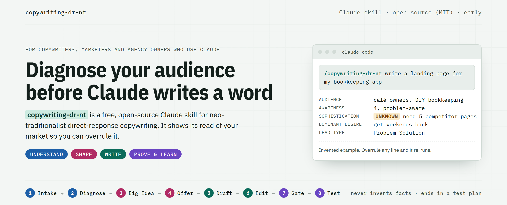

<p align="center">
  <picture>
    <source media="(prefers-color-scheme: dark)" srcset="assets/banner-dark.png">
    
  </picture>
</p>

<p align="center">
  <a href="https://github.com/mikhailkho/copywriting-dr-nt/stargazers"></a>
  <a href="LICENSE"></a>
  
  
</p>

<p align="center">
  <a href="#try-it"><b>Install</b></a> ·
  <a href="#same-brief-with-and-without-the-skill"><b>Before / after</b></a> ·
  <a href="#how-it-works"><b>How it works</b></a> ·
  <a href="#example-prompts-and-use-cases"><b>Example prompts</b></a> ·
  <a href="https://github.com/mikhailkho/copywriting-dr-nt">⭐ <b>Star this repo</b></a>
</p>

# copywriting-dr-nt

A Claude skill for **neo-traditionalist direct-response copywriting in the AI era**. It makes Claude diagnose your audience before it writes, tells you its diagnosis so you can overrule it, marks the facts it doesn't have instead of inventing them, and ends every job with a test plan.

It applies the classic direct-response method (research first, awareness × sophistication, one Big Idea, mechanism, specificity, offer, testing) as taught by Hopkins, Caples, Halbert, Schwartz, Whitman, Masterson and Forde, Kennedy, Bly, Todd Brown and Brunson, and uses AI to amplify human truth, not replace it. [Influences only; see Sources and attribution.](#sources-and-attribution)

## Status: early

- Built by one person, with Claude. Tested so far only by me.
- **No performance data.** I have no case studies showing it lifts conversions, and I won't make any up.
- **One field test so far, and the skill lost.** I compared a cold email written with the skill against a plain Claude draft, unlabelled. I preferred the plain one: the skill's version sounded like fluff. I changed the skill's rule for cold outreach from unknown senders (plain statements, admit missing proof, no hook questions, keep the opt-out line). See `knowledge/channels/b2b-and-service-businesses.md` §3a.
- I want real trials and honest feedback. See "Feedback" below.

## Try it

Built and tested for **Claude Code**. Other Claude surfaces are untested.

**Install, one line, inside Claude Code:**

```
/plugin install copywriting-dr-nt --marketplace mikhailkho/copywriting-dr-nt
```

Then run it:

```
/copywriting-dr-nt:copywriting-dr-nt write a cold email to [audience] for [offer]
/copywriting-dr-nt:copywriting-dr-nt review this landing page: <paste or path>
/copywriting-dr-nt:copywriting-dr-nt give me 30 subject lines for a win-back email
```

<details>
<summary>Other ways to install (shorter command, no plugin)</summary>

Clone it as a plain skill and the command is just `/copywriting-dr-nt`. For all your projects:

```
git clone https://github.com/mikhailkho/copywriting-dr-nt ~/.claude/skills/copywriting-dr-nt
```

Or for one project:

```
git clone https://github.com/mikhailkho/copywriting-dr-nt .claude/skills/copywriting-dr-nt
```

If the one-line plugin command isn't recognised, your Claude Code is probably older than 2.1.275. Run `/plugin marketplace add mikhailkho/copywriting-dr-nt`, then `/plugin install copywriting-dr-nt@copywriting-dr-nt`.

</details>

Argument hint: `[what to write or review] [audience/offer/channel if known]`.

Give it real facts: your offer, customer quotes and proof. Where you have none, it leaves `UNKNOWN` or a `[NEED: …]` bracket instead of guessing. Please don't paste confidential or personal customer data into any AI tool without authorisation.

## Same brief, with and without the skill

One real run of each, in Claude Code. Ledgerbean is an invented product. Full, unedited outputs are in [examples/ledgerbean-before-after.md](examples/ledgerbean-before-after.md).

> **The brief (identical for both):** Write the top of a landing page for Ledgerbean, a bookkeeping app for small independent cafes. Facts: it connects to Square and Stripe and sorts each transaction into a category automatically; $29 a month; 14-day free trial; the owners have no accounting background and do their own books on Sunday nights. No customer quotes, results or case studies yet.

| Plain Claude | With `/copywriting-dr-nt` |
|---|---|
| **Headline:** Your Sunday-night books, done before you sit down. | **Headline:** Your cafe's books, sorted before Sunday night. |
| **Subhead:** Ledgerbean connects to Square and Stripe and sorts every transaction into the right category automatically. No accounting degree required. | **Subhead:** Ledgerbean connects to Square and Stripe and puts every transaction in a category for you. Made for cafe owners who never studied accounting. |
| **Button:** Start your 14-day free trial | **Button:** Start my 14-day free trial, with the line under it: "$29/month after the trial. `[NEED: is a card required to start? how do you cancel?]`" |
| Short notes on its choices. | A diagnosis to overrule, 3 headline alternatives built on different ideas, a claims register, assumptions, 3 things to verify and one next test. |

**What to take from it, honestly:**

- Neither draft invented proof. Made-up claims like "saves hours a week" are a common failure in AI copy, and plain Claude avoided them here.
- The copy itself is close. You may prefer the plain version.
- The difference is the work around the copy. The skill flags that "sorted before Sunday night" depends on *when* the sorting happens, marks the card and cancellation terms as `[NEED: …]` instead of guessing, and ends with a test: headline as the one variable, trial starts per visitor as the metric, about 100 trial starts per version before calling a winner.
- It costs a longer reply. For a one-off line, plain Claude is faster.
- This is one brief and one run each. It is not a benchmark. If you try your own, I'd like to hear it (see "Feedback").

## What it does

Write, rewrite, critique, strategise or test persuasive copy:

- Headlines, hooks, subject lines and leads
- Sales letters, landing and sales pages, product pages
- Emails and sequences, ads, VSL/webinar scripts, B2B outreach
- Angles, Big Ideas, offers and test plans
- Traffic and audience planning: Dream 100, lead magnets, opt-in pages, retargeting, cold-traffic bridges

It diagnoses before it drafts (audience, awareness stage, sophistication stage, mass desire, Big Idea, offer), says the diagnosis out loud so you can veto it, and ends every deliverable with assumptions, three things to verify and the next test.

## How it works

You describe the job. The skill picks a mode, loads only the notes that job needs, and works in this order:

1. **Intake.** It asks for the one action you want, the offer, who it's for, real customer quotes and the proof you hold. Anything missing is marked `UNKNOWN` or `[NEED: …]`. If critical facts are missing, it writes a draft clearly labelled as a hypothesis and designs the first test to learn the missing fact.
2. **Diagnose.** It states the audience, awareness stage, sophistication stage, dominant desire, lead type and length logic. You can overrule any of it, and it re-runs.
3. **Big Idea.** It fills a one-page card: promise, proof ceiling, mechanism (only from true facts), one emotion, one action.
4. **Offer.** Deliverables, price, guarantee, bonus, reason why, and a deadline only if it is real.
5. **Draft.** One structure, in the native format of the channel, plus hook variants that differ in idea, not just wording.
6. **Edit.** A ten-pass edit aimed at AI tells: stock openers, abstract buzzwords, repeated contrast frames, vague social proof.
7. **Gate.** The copy review checklist, the compliance gate and a claims register (claim, evidence, status). Anything unverified is flagged or removed.
8. **Test.** A test plan with one variable, a metric, a sample rule and a results-log row.

Every deliverable ends with your assumptions, three things to verify before launch and the single next test. Short requests, such as a batch of subject lines, skip the heavy steps but keep the audience, the stage, one idea and a claims line.

### What a diagnosis looks like

This is an invented example of the format, not a real client or result:

```
AUDIENCE: owners of small cafés who do their own bookkeeping
AWARENESS STAGE: 4 (problem-aware). Evidence: [NEED: 10 customer quotes]
SOPHISTICATION STAGE: UNKNOWN until you share 5 competitor pages
DOMINANT DESIRE: get weekends back
LEAD ARCHETYPE: Problem-Solution, because the pain is known and the fix is not
LENGTH LOGIC: short page; low-risk first step, so a long argument isn't needed
```

Note the `UNKNOWN`. The skill is built to say what it doesn't know rather than fill the gap with something plausible.

## Example prompts and use cases

These are examples only, not scripts. Start your message with `/copywriting-dr-nt` (or `/copywriting-dr-nt:copywriting-dr-nt` if you installed it as a plugin), then type what you want written or reviewed. Replace the [brackets] with your own details, or write your own request. The more real detail you give, the less the skill has to mark as unknown.

| Use case | Example prompt | What you get |
|---|---|---|
| Write a landing page | `write a landing page for [product]. Audience: [who]. Offer: [price, guarantee]. Customer quotes: [paste].` | Diagnosis, Big Idea Card, page copy, headline variants, claims register, test plan |
| Review copy that isn't converting | `review this sales page: [paste]. Traffic comes from [source].` | Scored checklist, fixes ranked by leverage, rewrites of the weakest sections |
| Rewrite in your own voice | `rewrite this email in direct-response style but keep my voice: [paste]` | Before/after on the biggest changes, with the reason for each |
| Headlines and subject lines | `give me 30 subject lines for a win-back email to customers who haven't bought in 6 months. Offer: [offer].` | Variants across different lead types, scored on the 4 U's, a shortlist of 3–5 |
| Find an angle | `what angle should I use for [product] when every competitor says "faster and cheaper"? Competitors: [links]` | 3–5 candidate Big Ideas, each with the mechanism and proof it needs |
| Cold B2B outreach | `write a cold email to [role] at [company type]. I have no case studies yet.` | A plain draft that admits the proof gap, says what you do and don't do, and keeps the opt-out line |
| Paid social hooks | `write 10 Meta ad hooks for [offer], cold audience, [country].` | Hooks matched to awareness stage, with platform-policy flags |
| Email sequence | `plan a 5-email welcome sequence for people who downloaded [lead magnet].` | Arc, angle and call to action per email, metrics to track |
| Plan a test | `we ran two headline tests: [results]. What do we do next?` | Interpretation, a warning if the sample is too small, a log entry, the next test |
| Traffic and lead magnets | `help me plan where to find buyers for [offer], and a lead magnet.` | Dream 100 worksheet, earn/buy/own plan, lead magnet options |
| Ask the library | `what did Schwartz say about sophistication stages, and does it still hold?` | A short answer with provenance, and a note on what is durable and what is dated |

### Who it suits

- **Copywriters:** faster research and variants while you keep the judgment calls (the idea, the offer, the final edit).
- **In-house marketers:** a repeatable brief-to-test process, and a claims register to hand to legal or a manager.
- **Agency owners:** one process across clients, with a clear record of what was assumed.
- **Founders and solo operators:** a way to get a structured first draft and a first test without hiring.
- **Advertisers and media buyers:** hooks by awareness stage, a test plan, and platform and jurisdiction flags.

### Tips for better results

- Paste real customer quotes, reviews or sales-call lines. This matters more than any prompt wording.
- Say what you can prove and what you cannot. The skill caps its claims at your proof.
- Name the country and platform so the compliance flags are relevant.
- Ask for one job at a time. Treat any ranking it gives, and the model's own, as a hypothesis to test.

## Modes

| Mode | For |
|---|---|
| A. Create | Write a page, sequence, ad or script from scratch |
| B. Review | Critique copy and rank fixes by leverage |
| C. Upgrade | Rewrite existing copy in direct-response style |
| D. Strategy | Angles, Big Ideas, offers, lead types |
| E. Headlines/hooks | 20-50 variants, scored and shortlisted |
| F. Sequence/funnel | Value ladder, arc, per-touch angle and CTA |
| G. Test design | Test trees, plans, interpreting results |
| H. Library Q&A | What the classic authors said, with provenance |

## Ground rules baked in

- Never invents facts: missing information becomes `UNKNOWN` or a `[NEED: ...]` placeholder.
- Promise does not exceed proof; every claim goes in a claims register.
- Honest persuasion only: no fake urgency, dark patterns or hidden billing.
- Anti-AI-slop edit pass before delivery.
- Principles in its own words: it does not reproduce long passages from the source books.
- Every asset comes with a test plan; rankings (yours or the model's) are hypotheses.

## What it isn't

- It can't know your market. You supply the facts, quotes and proof.
- It isn't legal advice. The compliance gate lists regulatory signposts (for example Singapore SCAP/ASAS, CPFTA, PDPA, Spam Control Act, and US FTC rules). For health, finance, legal, income claims or children, get qualified review.
- It isn't one click. If you want a finished page from a single prompt with no inputs, this isn't it.

## Layout

```
SKILL.md                      skill definition and workflow (what Claude loads)
LICENSE                       MIT
CONTRIBUTING.md               how to contribute
.github/                      issue and pull request templates
.claude-plugin/               plugin and marketplace manifests (one-line install)
assets/                       README banner and social preview, with the HTML they are rendered from
examples/                     real before/after run: same brief with and without the skill
knowledge/
  README.md                   index and decision guide for the library
  00-neo-traditionalist-canon.md
  frameworks/                 12 notes: awareness, Big Idea, offer, leads, body copy, psychology, testing, traffic...
  channels/                   landing pages, email, paid social, ecommerce, B2B, direct mail
  checklists/                 brief intake, copy review, compliance and ethics, test plan
  books/                      empty; add your own private notes (git-ignored), see books/README.md
templates/
  deliverable-template.md     output format for create/review/upgrade
  results-log.csv             test results log
```

The library is read progressively: Claude loads only the notes the task needs, not everything.

## Sources and attribution

The frameworks draw on the work of Hopkins, Halbert, Schwartz, Caples, Whitman, Masterson and Forde, Kennedy, Bly, Todd Brown and Brunson. They are named as influences and for attribution only. The notes are summaries and frameworks in my own words, not reproductions of any book, and I have not published the per-book notes. None of these authors, and not Anthropic, has reviewed or endorsed this project. "Claude" is a product of Anthropic.

## Contributing

Marketers, advertisers, copywriters and subject-matter experts are welcome to contribute: trial reports, corrections, new channel guides, sector and jurisdiction compliance signposts, and better examples. Read [CONTRIBUTING.md](CONTRIBUTING.md) first. It lists what helps most and the few rules that keep the repo honest (no copied book text, no invented facts, no fake proof).

## Feedback

Tried it? Tell me what worked, what sounded like fluff, and what it got wrong: open an issue using the "Trial feedback" template.

## Work with me

I help marketers and businesses put Claude skills and workflows to work: setting them up around your own brand voice, customer language and proof, and training your team to use them. If you want a Claude-driven marketing consultation, message me on [LinkedIn](https://www.linkedin.com/in/mikhail-kho/).

Mikhail Kho, Marketing Manager

## License

MIT. See `LICENSE`.
